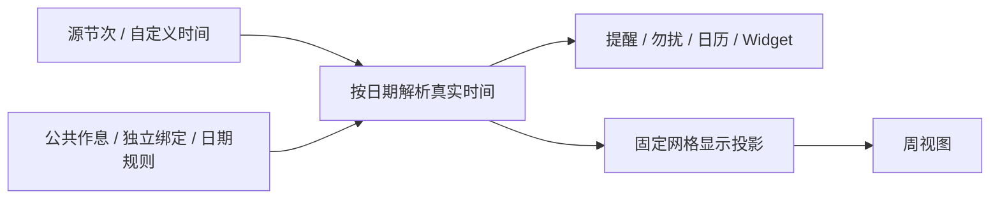

# 课程时间、作息与交换格式

本模型从 Room 50 开始使用。上游交换格式以 [拾光 v2.1.0](https://github.com/ShiGuangSchedule/shiguangschedule/tree/feabb68f75c4058319b449287980b5f645eb8d61) 为基线；SleepDown 在 `sleepdown` 命名空间保留扩展。实施与验证记录见 [本轮报告](../reports/2026-10-26-course-time-model-refactor.md)。

## 数据归属

`courses` 保存课程元数据、时间模式、独立作息引用、学分和来源信息。`course_sections`、`course_weeks`、`course_clock_segments` 分别保存源节次、实际有效周次和明确指定的时间；子记录随课程事务写入和删除。单双周在写入时展开为有效周次。

- `FOLLOW_TABLE`：按课程日期选取课表作息，部分节次可以有明确的时间覆盖。
- `FOLLOW_SCHEME`：仅兼容旧数据与交换格式。单节课编辑不再提供引用其他作息的入口；旧课程进入编辑时，将对应铃声转为自定义时间，确认保存后解除引用。
- `CUSTOM`：保存整体时段，或完整的逐节时段。更换基准作息不改动这些时刻。

新导入中另一教学楼等特殊作息直接转为课程的 `CUSTOM` 真实时间，不为单节课创建或绑定公共作息。日期作息仍属于课表级规则。旧备份与口令中的独立作息引用可读，预览和确认导入时按其真实时钟转换；源节次、有效周次及逐节覆盖保留。旧引用缺失时阻止写入，避免误用课表作息。

`period_schemes` / `period_scheme_times` 是节次作息的事实来源。`schedule_config.activePeriodSchemeId` 指定固定显示基准，`periods` 是只读数据库视图。旧 `CourseEntity` 保留为领域兼容门面，不再直接对应一张 Room 表。

组合作息保存于 `timetable_combos` 和按优先级排列的 `timetable_date_rules`。日期首尾均包含；多个规则命中时采用第一条。目标模板缺少的节次沿用组合基准，多余节次不加入显示基准，与拾光一致。

## 解析与显示

当天课程的实际时间与原节次不一致时，周视图当前周左侧表头临时替换对应节次的时钟。仅数字标在异常时段进行时改黄，时间文字不变色；过了当天或浏览其他周恢复基准。逐节时间精确替换各行，整体范围只替换首尾边界，不推造中间铃声；源节次、保存的作息及定位网格保持不变。日视图复用同一数字标规则。

`resolveCourseOccurrence` 根据源安排、日期与作息目录生成真实时间；`projectWeekGrid` 只计算显示位置。投影不得写回节次或时间字段。提醒、勿扰、日视图、Widget 与 ICS 消费真实时间，周视图保留单一节次网格，不为自定义、独立或其他日期的时钟插入额外时间行。当前周的时间轴显示当天日期作息，其他周显示基准作息；缺少的节次沿用基准。偏离网格的时间只在课程卡片上下沿居中标注，正文不重复显示；完全落在网格之外的课程使用最近的边缘节次区域承载，保留真实起止标签。

特殊课程的 JSON 保留原有字段，追加 `displayMode`、`location`、`note`、`startWeek`、`endWeek`，旧数据默认独立显示且整学期有效。独立显示沿用节次边界占位；占位模式覆盖现有时间段，相邻可用星期合并成卡片，正式课程优先；智能模式仅在该时段整周没有正式课程时压缩对应空行并显示时间胶囊，其他情况使用占位模式。判断按正在浏览的周进行，保留源节次及作息编号；地点、备注和有效周次可在特殊课程编辑中修改。

缺少模板或节次时保留课程，标记缺失部分并提示确认；不按默认时间补造未知部分。公共库修改更新引用；课表内修改生成专用副本。自定义时间与独立绑定不能通过周网格拖动被隐式改成普通节次课程。

非本周课程以正在浏览的周为准，仅在还存在后续有效周次时灰色预告。单双周的最后有效周次决定结课边界，灰色预告不进入提醒或日历数据。

## JSON 与 Bridge

标准文档包含 `courses`、`timeSlots`、`config`、`comboSchedule`。课程使用 `name`、`teacher`、`position`、`day`、`startSection` / `endSection`、`weeks`、`isCustomTime`、`customStartTime` / `customEndTime`、`color`、`remark`、`credit`。`color` 是拾光调色板索引，不能当作 ARGB。

`timeSlots` 使用 `number`、`startTime`、`endTime`、`alias`；节次可以稀疏，不能重新编号。重叠的来源作息转换为课程明确时刻，保留原编号与来源，显示基准继续使用当前作息。纯自定义时间不生成虚假的源节次。

SleepDown 扩展版本为 `sleepdown.version = 1`。文档的 `sleepdown.timetables` 使用文档内 ID 保存独立模板；每个课程的 `sleepdown` 保存 `groupId`、`mode`、`periods`、`timetableId`、整体或逐节时间、来源时间及 ARGB。不连续节次在标准字段中拆为多段，由分组扩展还原；标准字段与扩展不一致时拒绝导入。数据库 ID 不作为跨设备身份。

Bridge `saveComboSchedule` 必须在 `savePresetTimeSlots` 成功后调用；保存组合后不能再次替换基准。官方 WakeUp 适配器保留 `ownTime`，通过现有预览确认入口导入。上游脚本、来源与许可证仍保留。

新分享与 AI 历史写入上述文档。旧 JSON、SDCT1 与旧历史仍有读适配器；旧 `TIME` 对齐语义在读取时转成明确的原始时间。AI 工作区的补丁接口是本地编辑协议，不是新的公开交换格式。ICS 同时生成实际日期事件及可还原完整安排的折行扩展。

## 升级与备份

Room 1～49 升级前，在应用私有 `noBackupFilesDir/database-upgrades` 创建一致性 SQLite 副本，包含已提交的 WAL 内容、表、显式索引、序列和数据库版本。备份失败则停止升级。49→50 迁移保留课程 ID 和原始来源；无法可靠转换的记录保留原文并标记待确认。

`.sleepdown` 容器格式仍为 1，数据版本为 2，新增独立绑定、时间元数据、别名与组合关系；继续读取数据版本 1。恢复时重建模板与组合的 ID 映射，旧包导出后在新包恢复的迁移路径保留。升级副本、用户数据和构建产物不进入 Git。
